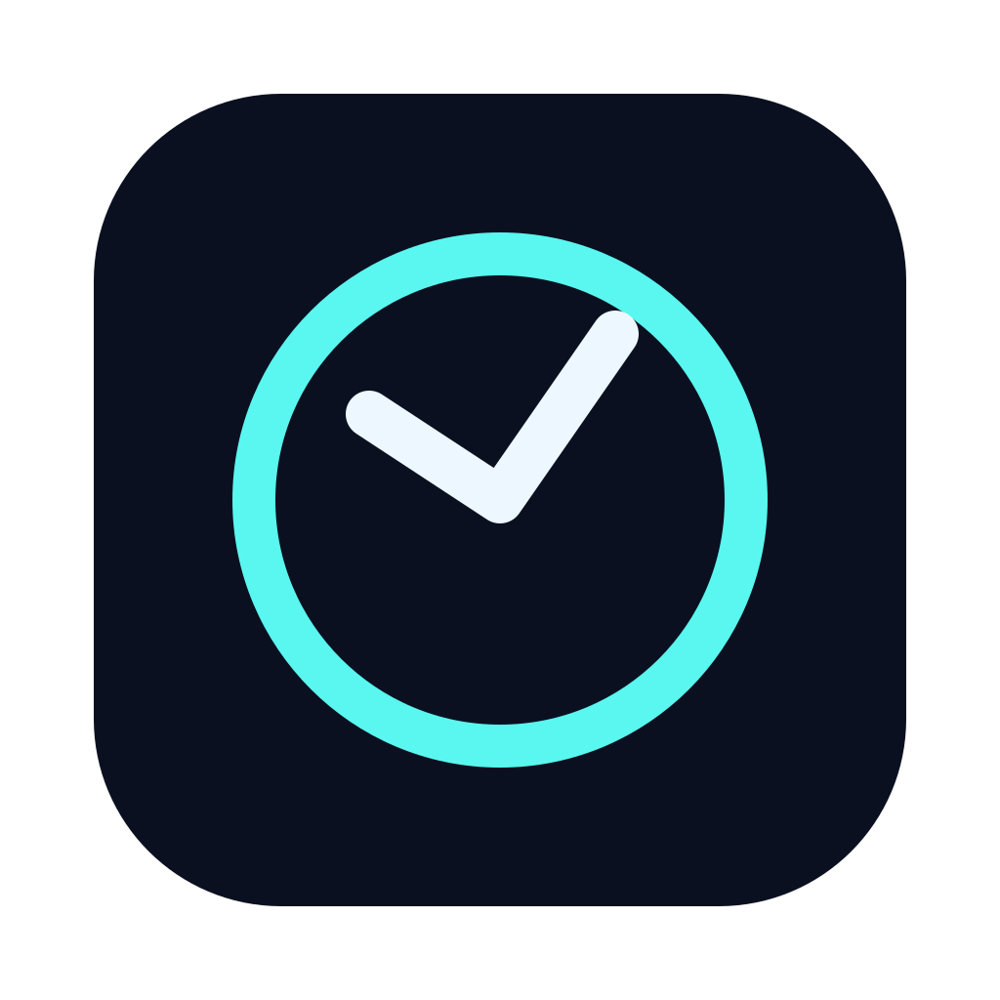

<p align="center">
  
</p>

# Desktop Timer

A cyberpunk macOS menu bar timer with Pomodoro sessions and blurred reminders to move, stretch, and look around.

## Install

Requires macOS 11 or later. The current download supports **Apple Silicon** (M-series Macs).

1. [Download the latest DMG](https://github.com/Khaled2049/desktop-timer/releases/latest).
2. Open it and drag **Desktop Timer** into **Applications**.
3. Launch the app and click its menu bar icon to get started.

The app is not notarized. If macOS blocks it, attempt to open it, then go to **System Settings → Privacy & Security → Open Anyway** if you trust the download. [Apple’s instructions](https://support.apple.com/en-us/102445).

## Use

- **Control + S** starts, pauses, or resumes the timer from any app.
- Choose a preset or set a custom countdown.
- **Pomodoro:** 25-minute focus sessions, 5-minute breaks, and a 15-minute break after four sessions.
- When time runs out, a blurred reminder appears. Use its button or **Escape** to dismiss it. In Pomodoro mode, the button or **Control + S** starts the next phase.

Closing settings keeps the timer running. Quit from the menu bar to exit.

## Develop

Install [Node.js](https://nodejs.org/) 22.12+, [Rust](https://rustup.rs/), and Xcode Command Line Tools (`xcode-select --install`), then run:

```sh
npm ci
npm run tauri dev
```

Build a macOS installer:

```sh
APPLE_SIGNING_IDENTITY="-" npm run tauri build -- --bundles dmg
```

Find the DMG in `src-tauri/target/release/bundle/dmg/`. Allow your terminal to control Finder in **Privacy & Security → Automation** if packaging requests it.

Bug reports and pull requests are welcome. If Desktop Timer helps you take better breaks, [give it a ⭐](https://github.com/Khaled2049/desktop-timer)!
